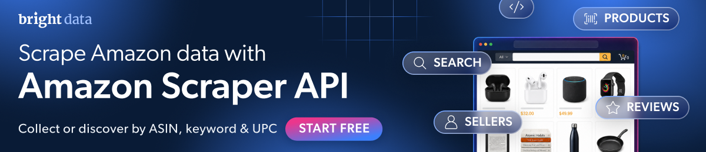

[](https://www.bright.cn/products/web-scraper/amazon?utm_source=github)

# amazon-scraper-node

[](https://github.com/bright-cn/amazon-scraper-node/actions/workflows/live.yml) [](https://github.com/bright-cn/amazon-scraper-node/actions/workflows/live.yml) <!-- verified: rewritten by the daily run -->

[快速入门](#快速入门) · [命令](#或者将其作为命令运行) · [端点](#api-的其余部分) · [数据](#数据) · [错误](#失败时) · [编程智能体](#编程智能体) · [文档](https://docs.brightdata.com/products/scrapers/amazon/introduction) · [支持](#支持)

使用 JavaScript，以 JSON 格式获取 Amazon 商品、评论、卖家和搜索结果。无需登录，也无需浏览器。基于 [Bright Data Amazon 爬虫工具 API](https://www.bright.cn/products/web-scraper/amazon?utm_source=github) 构建。

使用 [Bright Data JavaScript SDK](https://github.com/bright-cn/sdk-js)。完整 API 文档：[Amazon 爬虫工具 API](https://docs.brightdata.com/products/scrapers/amazon/introduction)。

这里还提供：用于商品的一条命令 CLI，以及完全不需要 JavaScript 的 [Bright Data CLI](#编程智能体)。

## 快速入门

需要 Node 20 或更高版本。此软件包使用 ESM，因此请使用 `import`，不要使用 `require`。

```bash
npm install @brightdata/sdk
export BRIGHTDATA_API_TOKEN=YOUR_API_KEY
```

从 [Bright Data 控制面板](https://www.bright.cn/cp/setting/users)获取令牌。此 SDK 不读取 `.env` 文件；Node 会使用 `node --env-file=.env yourscript.mjs` 为其加载该文件。

你也可以跳过令牌。运行一次 `npx -p @brightdata/cli bdata login`：它会打开浏览器，之后 SDK 会自行找到已存储的凭据，供你以及在该终端中工作的任何编程智能体使用。智能体无法点击完成登录，因此请先自行登录。

还没有账户？[创建账户](https://www.bright.cn/cp/start)；新账户[每月可获得 5,000 个免费积分](https://docs.brightdata.com/general/account/billing-and-pricing/free-tier)。

```javascript
import { bdclient } from "@brightdata/sdk";

const client = new bdclient({ autoCreateZones: false });
const job = await client.scrape.amazon.collectProducts(
  ["https://www.amazon.com/dp/B0CRMZHDG8"],
  { async: true, includeErrors: true },
);
const result = await job.toResult({ pollTimeout: 600_000 });
if (!result.success) throw new Error(`${result.status}: ${result.error}`);
const [product] = result.data;
console.log(product.title);
console.log(product.final_price, product.currency, "|", product.rating, "stars |", product.reviews_count, "reviews");
await client.close();
```

```
STANLEY Quencher H2.0 Flow State Tumbler, 40 oz, Fuchsia
39.95 USD | 4.7 stars | 205036 reviews
```

每个商品消耗一个[积分](https://www.bright.cn/pricing/web-scraper)，API 给出的预估时间约为每个输入 7 秒。

该代码片段中有三项不是可选的。

`autoCreateZones: false` 会阻止 SDK 在启动时创建区域。这些区域用于网络解锁器和搜索引擎 API，它们是此爬虫从不使用的另外两款 Bright Data 产品。没有付款方式的账户无法创建区域。

`includeErrors: true` 让 API 将无效 ASIN 报告为一行。没有它，该行会被丢弃，你将得不到任何结果。

`async: true` 让 `collectProducts` 返回一个任务，而不是通过会在一分钟后放弃的同步端点执行。

`pollTimeout` 的单位是毫秒，而不是秒。从 Python 示例复制的数值会在第一次状态检查前就超时。

SDK 的商品筛选器接受 `url`、`zipcode` 和 `language`。API 还接受 `asin`、`origin_url` 和 `all_variations`，但筛选器会拒绝这三者，因此请像上面那样，将 ASIN 作为 `/dp/` URL 传入。

## 或者将其作为命令运行

此仓库中的命令会对多个 ASIN 执行相同操作，并写入一个 JSON 文件。

```bash
npm install -g github:bright-cn/amazon-scraper-node
amazon-scraper B0CRMZHDG8 B085DVHQ57
```

```
Fetching 2 Amazon products: B0CRMZHDG8, B085DVHQ57
One job for all of them. One credit per product.
asking  2 products...
got     B0CRMZHDG8: 99 fields (STANLEY Quencher H2.0 Flow State Tumbler, 40 oz,)
got     B085DVHQ57: 100 fields (Owala FreeSip Stainless Steel Water Bottle 32 oz)

Saved 2 of 2 products as JSON to amazon.json
```

它既可以接收商品 URL，也可以接收其中的 ASIN，因此 `amazon-scraper https://www.amazon.com/dp/B0CRMZHDG8` 的作用相同。相同 ASIN 出现两次时只会抓取一次，因此重复项不会产生费用。

在终端中，`asking` 行会被以下内容原地替换，让你可以看到它正在运行以及已运行多长时间：

```
⠹ 2 products 0:00:11
```

```
--out PATH   output file, default amazon.json
```

你请求的每个 ASIN 都会放入同一个任务。API 按记录而非任务计费，因此获取十个商品与获取一个商品的等待时间相同。

如果导入而不是运行它，则每个 ASIN 会得到 `ok` 和 `error`，而不是原始行。`scrape` 不会因某个无效 ASIN 而拒绝；读取 `product` 前请检查 `ok`：

```javascript
import { scrape } from "@brightdata/amazon-scraper-node";

for (const outcome of await scrape(["B0CRMZHDG8", "B0ZZZZZZZZ"])) {
  if (outcome.ok) {
    console.log(`${outcome.asin}: ${outcome.product.title}`);
  } else {
    console.log(`${outcome.asin} failed: ${outcome.error}`);
  }
}
```

```
B0CRMZHDG8: STANLEY Quencher H2.0 Flow State Tumbler, 40 oz, Fuchsia
B0ZZZZZZZZ failed: The navigation resulted in a dead page (404 status code)
```

## API 的其余部分

该命令涵盖下表第一行。这里的每个代码片段都是完整的，只需要 `@brightdata/sdk`：可直接粘贴使用。它们每周一都会在 Actions 中运行，每隔一天还会执行一次较小的检查，顶部徽章显示的是最新结果。

| 你拥有 | 你想要 | 调用 |
| --- | --- | --- |
| ASIN 或商品 URL | 该商品 | `collectProducts([url], { async: true, includeErrors: true })` |
| 关键词 | 匹配的商品 | `discoverProductsByKeyword([{ keyword }], { async: true, includeErrors: true, limitPerInput: 3 })` |
| 分类 URL | 其中的商品 | `discoverProductsByCategoryURL([{ url }], …)` |
| 畅销商品 URL | 其中的商品 | `discoverProductsByBestSellerURL([{ category_url }], …)` |
| UPC | 匹配的商品 | `discoverProductsByUPC([{ upc }], …)` |
| 卖家 URL | 该卖家 | `collectSellers([url], { async: true, includeErrors: true })` |
| 关键词和店铺 URL | 搜索页面 | `collectProductSearch([{ keyword, url }], …)` |
| 商品 URL | 其评论 | `collectReviews([url], …)`，每条评论消耗一个积分，另请参阅下文 |

它们都挂载在 `client.scrape.amazon` 下。

### 这里不运行评论抓取，原因是费用

评论按每条一个积分计费，而且无法通过此 SDK 有效地请求更少评论。

API 接受 `max_reviews` 输入，Bright Data 自己的文档示例将其设为 20。SDK 的评论筛选器仅声明了 `url` 和 `reviews_to_not_include`，并拒绝 `max_reviews`。SDK 自身的上限 `limitPerInput` 在评论数据集中会返回零行；该结果已在两个商品上测量三次，而它在商品数据集上运行正常（[sdk-js#37](https://github.com/brightdata/sdk-js/issues/37)）。

因此，只有不设上限的评论调用能返回内容。此 README 快速入门中的商品显示有 205,036 条评论。这只需一次调用。

请先检查商品上的 `reviews_count`；在 SDK 支持 `max_reviews` 之前，如果你需要数量有限的数据切片，请直接调用 REST 端点。

### 上限，以及会悄悄移除上限的标志

`limitPerInput` 用于限制发现调用的数量。只有同时传入 `async: true` 时才有效：如果没有该键，选项会匹配 SDK 选项架构的同步部分，它会丢弃不认识的键，且上限会无报错地消失（[sdk-js#36](https://github.com/brightdata/sdk-js/issues/36)）。SDK 的 `DiscoverOptions` 类型会提示你省略 `async`，因此类型正确的调用反而是不设上限的调用。

这里的每个发现代码片段都会同时传入两者。

### 按关键词查找商品

```javascript
import { bdclient } from "@brightdata/sdk";

const client = new bdclient({ autoCreateZones: false });
const job = await client.scrape.amazon.discoverProductsByKeyword(
  [{ keyword: "stainless steel water bottle" }],
  { async: true, includeErrors: true, limitPerInput: 3 },
);
const result = await job.toResult({ pollTimeout: 900_000 });
if (!result.success) throw new Error(`${result.status}: ${result.error}`);
for (const product of result.data) {
  console.log(product.asin, "|", product.final_price, product.currency, "|", product.title.slice(0, 40));
}
await client.close();
```

```
B0D2W1MKZX | 14.24 USD | Fijinhom Insulated Water Bottle with Han
B085DVHQ57 | 29.99 USD | Owala FreeSip Stainless Steel Water Bott
B0D8J2ZB8P | 14.24 USD | POWCAN 26 oz Insulated Water Bottle with
```

如果没有 `limitPerInput`，该调用会返回所有匹配项，每项按一个积分计费。

### 多个商品，一个任务

URL 数组会作为一个任务，而不是每个商品一个任务。

```javascript
import { bdclient } from "@brightdata/sdk";

const client = new bdclient({ autoCreateZones: false });
const job = await client.scrape.amazon.collectProducts(
  ["https://www.amazon.com/dp/B0CRMZHDG8", "https://www.amazon.com/dp/B085DVHQ57"],
  { async: true, includeErrors: true },
);
const result = await job.toResult({ pollTimeout: 600_000 });
if (!result.success) throw new Error(`${result.status}: ${result.error}`);
for (const product of result.data) {
  console.log(product.asin, "|", product.brand, "|", product.final_price, product.currency);
}
await client.close();
```

```
B085DVHQ57 | Owala | 29.99 USD
B0CRMZHDG8 | STANLEY | 39.95 USD
```

返回行的顺序没有保证。请使用每行自己的 `asin` 将其与你的请求对应，而不要根据位置匹配。

### 立即触发，稍后获取

对于超过少量商品的任务，不要阻塞进程一小时。触发任务、保存快照 ID，并在就绪后获取。快照可在 30 天内下载。

```javascript
import { bdclient } from "@brightdata/sdk";

const client = new bdclient({ autoCreateZones: false });
const job = await client.scrape.amazon.collectProducts(
  ["https://www.amazon.com/dp/B0CRMZHDG8"],
  { async: true, includeErrors: true },
);
console.log("snapshot:", job.snapshotId);
await job.wait({ pollInterval: 5_000, pollTimeout: 600_000 });
console.log("status:", await job.status());
const [record] = await job.fetch();
console.log("fetched:", record.asin, "|", record.title.slice(0, 40));
await client.close();
```

```
snapshot: sd_mu9ycsw7zyq04t1uw
status: ready
fetched: B0CRMZHDG8 | STANLEY Quencher H2.0 Flow State Tumbler
```

## 数据

大多数人想从商品中获取的字段：

```
asin  title  brand  final_price  currency  rating  reviews_count  availability
```

代码没有硬编码任何字段列表。API 返回的所有内容都会进入 `result.data`，也会写入命令生成的文件。

API 在架构中使用 `pii: true` 将其中 3 个字段标记为个人数据：`seller_name`、`zipcode` 和 `coupon`。

<!-- fields:start -->
<details>
<summary>全部 121 个字段及其类型和说明</summary>

每天通过 `client.datasets.amazonProducts.getMetadata()` 根据数据集架构重新生成，因此不会过时。商品会包含适用于它的字段：示例文件包含这 121 个字段中的 97 个，外加架构未列出的 `timestamp` 和 `input`。

| 字段 | 类型 | 说明 |
| --- | --- | --- |
| `title` | 文本 | 商品标题 |
| `seller_name` | 文本 | 个人数据。卖家名称 |
| `brand` | 文本 | 商品品牌 |
| `description` | 文本 | 商品的简要说明 |
| `initial_price` | 价格 | 初始价格 |
| `currency` | 文本 | 商品币种 |
| `availability` | 文本 | 商品库存状态 |
| `reviews_count` | 数字 | 评论数量 |
| `categories` | 数组 | 商品分类 |
| `parent_asin` | 文本 | 商品的父 ASIN |
| `asin` | 文本 | 每个商品的唯一标识符 |
| `buybox_seller` | 文本 | 购物车中的卖家 |
| `number_of_sellers` | 数字 | 商品的卖家数量 |
| `root_bs_rank` | 数字 | 大类中的畅销商品排名 |
| `ISBN10` | 文本 | 图书的 ISBN-10 标识符 |
| `answered_questions` | 数字 | 已回答的问题数量 |
| `domain` | URL | 商品域名 URL |
| `images_count` | 数字 | 图片数量 |
| `url` | URL | 直接链接到商品的 URL |
| `video_count` | 数字 | 视频数量 |
| `image_url` | URL | 直接链接到商品图片的 URL |
| `item_weight` | 文本 | 商品重量 |
| `rating` | 数字 | 商品评分 |
| `product_dimensions` | 文本 | 商品尺寸 |
| `seller_id` | 文本 | 每个卖家的唯一标识符 |
| `image` | URL | 直接链接到商品图片的 URL |
| `date_first_available` | 文本 | 商品首次上架日期 |
| `discount` | 文本 | 商品折扣信息 |
| `model_number` | 文本 | 商品型号 |
| `manufacturer` | 文本 | 商品制造商 |
| `department` | 文本 | 商品所属部门 |
| `plus_content` | 布尔值 | 表示是否存在附加内容的布尔值 |
| `upc` | 文本 | 通用产品代码 |
| `video` | 布尔值 | 表示是否存在视频的布尔值 |
| `top_review` | 文本 | 商品的热门评论 |
| `final_price_high` | 价格 | 最终价格为区间时的最高值 |
| `final_price` | 价格 | 商品最终价格 |
| `variations` | 数组 | 同一商品不同变体的详细信息 |
| `delivery` | 数组 | 配送相关信息 |
| `features` | 数组 | 商品特性 |
| `format` | 数组 | 图书格式相关信息 |
| `buybox_prices` | 对象 | 商品价格详情 |
| `input_asin` | 文本 | 输入的 ASIN（当前未启用） |
| `ingredients` | 文本 | 商品配料，主要适用于食品 |
| `origin_url` | URL | 用于提取此记录的源页面 URL |
| `bought_past_month` | 数字 | 过去一个月的购买件数（Amazon 显示的数据） |
| `is_available` | 布尔值 | 表示商品是否仍然有货 |
| `root_bs_category` | 文本 | 畅销商品根分类 |
| `bs_category` | 文本 | 畅销商品分类 |
| `bs_rank` | 数字 | 特定分类中的畅销商品排名 |
| `badge` | 文本 | 商品徽章。例如：#1 Best Seller 或 Amazons Choice |
| `subcategory_rank` | 数组 | 按子分类划分的畅销商品排名条目 |
| `amazon_choice` | 布尔值 | 指定商品是否为 Amazons Choice |
| `images` | 数组 | 商品图片 URL |
| `product_details` | 数组 | 完整商品详情 |
| `prices_breakdown` | 对象 | 标价/典型价格及优惠状态明细 |
| `country_of_origin` | 文本 | 商品原产国 |
| `from_the_brand` | 数组 | 页面上显示的品牌宣传媒体 |
| `product_description` | 数组 | 嵌入商品说明部分的媒体 |
| `seller_url` | URL | Amazon 上的卖家店面/个人资料 URL |
| `customer_says` | 文本 | customer_says |
| `sustainability_features` | 数组 | 带参考信息的可持续性徽章/认证 |
| `climate_pledge_friendly` | 布尔值 | 商品是否显示 Climate Pledge Friendly 徽章 |
| `videos` | 数组 | 商品视频 URL |
| `other_sellers_prices` | 数组 | 同一商品的其他卖家报价 |
| `downloadable_videos` | 数组 | 直接媒体 URL |
| `editorial_reviews` | 数组 | 图书的编辑评论 |
| `about_the_author` | 文本 | 作者简介信息 |
| `zipcode` | 文本 | 个人数据。用于配送和库存估算的邮政编码 |
| `coupon` | 文本 | 个人数据。优惠券 |
| `sponsered` | 布尔值 | 赞助内容 |
| `store_url` | URL | 商品的店铺 URL |
| `ships_from` | 文本 | 商品发货地 |
| `city` | 文本 | 与配送或卖家/地点上下文相关的城市 |
| `customers_say` | 对象 | 从评论中提取的 Amazon“买家评价”摘要 |
| `max_quantity_available` | 数字 | 允许加入购物车的最大数量 |
| `variations_values` | 数组 | 变体及其可能值 |
| `language` | 文本 | 商品页面/内容的语言 |
| `return_policy` | 文本 | 商品页面上显示的退货政策文本 |
| `inactive_buy_box` | 对象 | 购物车不可用/未启用时的价格信息 |
| `buybox_seller_rating` | 数字 | 购物车卖家的评分 |
| `premium_brand` | 布尔值 | 是否为高端品牌 |
| `amazon_prime` | 布尔值 | 是否支持 Amazon Prime 配送 |
| `coupon_description` | 文本 | 优惠券说明 |
| `all_badges` | 数组 | 所有徽章 |
| `sponsored` | 布尔值 | Amazon 赞助内容标志 |
| `variant_id` | 文本 | 特定变体的唯一标识符 |
| `product_category` | 文本 | 使用分隔符连接的完整面包屑路径 |
| `category_tree` | 数组 | 由名称和 URL 对象组成的分类层级数组 |
| `availability_date` | 文本 | 缺货商品的预计到货日期 |
| `listing_has_variations` | 布尔值 | 商品信息是否包含多个变体 |
| `variant_attributes` | 数组 | 名称/值对形式的当前变体属性 |
| `variants` | 数组 | 按类型分组的结构化变体选项 |
| `seller_privacy_policy` | 文本 | 卖家隐私政策 URL |
| `seller_tos` | 文本 | 卖家服务条款 URL |
| `return_window` | 数字 | 退货期限天数 |
| `target_countries` | 数组 | 商品可配送到的国家/地区 |
| `store_country` | 文本 | store_country |
| `category_urls` | 数组 | 分类面包屑 |
| `all_variations` | 布尔值 | 用于采集所有变体的输入字段 |
| `safety_information` | 文本 | 安全信息 |
| `subcategory_link` | 数组 | 按子分类划分的畅销商品链接条目 |
| `all_inactive_buy_box` | 数组 | 所有未启用的购物车信息 |
| `is_frequently_returned_item_badge` | 布尔值 | 表示该徽章是否存在 |
| `frequently_returned_item_message` | 文本 | 警告框中显示的文本 |
| `is_customers_usually_keep` | 布尔值 | 表示客户通常是否会保留此商品 |
| `title_badge` | 文本 | 徽章标题 |
| `review_images` | 数组 | review_images |
| `review_videos` | 数组 | review_videos |
| `also_viewed` | 数组 | 客户还浏览了 |
| `similar_items` | 数组 | 考虑类似商品 |
| `bought_past_month_text` | 文本 | 过去一个月的购买件数（Amazon 显示的数据），采用文本格式。 |
| `is_high_price` | 布尔值 | 表示商品是否被标记为高价。 |
| `title_highlight` | 文本 | 采集 Amazon 在商品页面上紧接商品标题后直接呈现的补充营销/亮点文本 |
| `title_clean` | 文本 | 由卖家/品牌定义的实际商品标题，不包括 Amazon 可能在页面标题旁边或之后呈现的任何亮点文本 |
| `customers_say_topics` | 数组 | “买家评价”部分的结构化明细 |
| `brand_url` | URL | 商品品牌 URL |
| `variant_condition` | 文本 | 商品变体的状态（例如全新、翻新、翻新 - 极佳）。 |
| `is_aplus_premium` | 布尔值 | 表示商品是否为 Premium A+ |
| `buying_option_type` | 文本 | 购买选项类型 |
| `amazon_checkout_promotion` | 对象 | 商品的结账促销 |

</details>
<!-- fields:end -->

<details>
<summary>真实输出文件的开头，来自 <code>amazon-scraper B0CRMZHDG8</code></summary>

```json
{
  "generated_at": "2026-09-20T15:10:50.120Z",
  "products": [
    {
      "asin": "B0CRMZHDG8",
      "product": {
        "title": "STANLEY Quencher H2.0 Flow State Tumbler, 40 oz, Fuchsia",
        "seller_name": "Avrix Brands",
        "brand": "STANLEY",
        "description": "Constructed of recycled stainless steel for sustainable sipping, our 40 oz Quencher H2.0 offers maximum hydration with fewer refills. Commuting, studio workouts, day trips or your front porch—you’ll want this tumbler by your side. Thanks to Stanley’s vacuum insulation, your water will stay ice-cold, hour after hour. The advanced FlowState™ lid features a rotating cover with three positions: a straw opening designed to resist splashes while holding the reusable straw in place, a drink opening, and a full-cover top. The ergonomic handle includes comfort-grip inserts for easy carrying, and the narrow base fits just about any car cup holder.",
        "initial_price": 45,
        "currency": "USD",
        "availability": "In Stock",
        "reviews_count": 205036,
        "categories": [
          "Home & Kitchen",
          "Kitchen & Dining",
          "Storage & Organization",
          "Thermoses",
  ...
```

包含一个商品及其所有字段的完整文件位于 [examples/sample_output.json](examples/sample_output.json)。

</details>

## 失败时

| 你会看到 | 含义 |
| --- | --- |
| `API token required but not found.` | 退出代码 2，在任何请求前发生。请设置令牌。 |
| `failed  ASIN: ...` | 退出代码 1。没有该商品，通常是 ASIN 输入错误。 |
| `failed  ASIN: the API returned no row for this ASIN` | 退出代码 1。任务返回时缺少该输入对应的行。请重新运行。 |
| `failed  ASIN: Polling timed out after 605s for sd_...` | 退出代码 1。请求在 600 秒后放弃。请重新运行。 |

任何失败都会以代码 1 退出，因此可安全地根据运行结果决定是否继续执行脚本。

在 SDK 中，相同情况如下所示：

| 你会看到 | 含义 |
| --- | --- |
| `AuthenticationError: No API token found.` | 任何位置都没有令牌：选项、环境或 CLI 登录中均无令牌。 |
| 状态为 401 的 `APIError` | 令牌已设置，但不正确。 |
| `result.success` 为 `false`，`result.status` 为 `"timeout"` | SDK 已放弃等待。请增加 `pollTimeout`（单位为毫秒），或重新运行。 |
| `result.data` 中含有 `error` 键的一行 | 当你请求 `includeErrors` 时，API 针对某个输入的响应。其他行不受影响。 |
| 成功结果中有零行 | 在评论数据集中，这就是 `limitPerInput`。移除它，并留意费用。 |

## 编程智能体

无需 JavaScript，也无需安装任何内容。粘贴以下两行；第一行会打开一次浏览器，也可以通过 SSH 和 CI 使用 `bdata login --device`：

```bash
npx -p @brightdata/cli bdata login
npx -p @brightdata/cli bdata pipelines run gd_l7q7dkf244hwjntr0 collect_by_url "https://www.amazon.com/dp/B0CRMZHDG8"
```

这是 CLI 0.4.0 的语法；旧的 `bdata pipelines amazon_product` 形式已在该版本中移除。`bdata pipelines search amazon` 用于查找爬虫 ID。Amazon 对应的 ID 为 `gd_l7q7dkf244hwjntr0`（商品）、`gd_le8e811kzy4ggddlq`（评论）和 `gd_lwdb4vjm1ehb499uxs`（搜索），均使用 `collect_by_url` 方法。`bdata pipelines info <id> collect_by_url` 会列出抓取工具的输入字段。每个工具都接受 URL、输出 JSON，并按每条记录一个积分计费。

`npx skills add brightdata/skills` 会让 Claude Code、Cursor 和 Codex 学会这些命令并了解相关文档，之后即可使用自然语言操作。完整指南：[面向编程智能体的 Bright Data](https://docs.brightdata.com/quickstart-coding-agent)。

托管式助手没有终端？[Bright Data MCP 服务器](https://github.com/bright-cn/brightdata-mcp#which-tool-to-use)在其 `ecommerce` 组中提供 Amazon 工具；除非你明确请求，否则该组默认关闭：

    https://mcp.brightdata.com/mcp?token=YOUR_API_TOKEN&groups=ecommerce

智能体也可以自行开设账户，无需注册表单：[智能体注册](https://brightdata.com/auth.md)。Bright Data 连接的其他所有服务，从 LangChain 到 Zapier 和 n8n：[集成](https://docs.brightdata.com/integrations/introduction)。

## 支持

此仓库中的错误：[提交问题](https://github.com/bright-cn/amazon-scraper-node/issues)，[CONTRIBUTING.md](CONTRIBUTING.md) 说明了需要提供哪些信息。有关 API、账户或积分的任何问题：[Bright Data 支持](https://brightdata.zendesk.com/hc/en-us/requests/new)。

## 许可证

[Apache 2.0](LICENSE)。

## Python 版本

同一款 Amazon 爬虫也提供 Python 版本：[bright-cn/amazon-scraper-python](https://github.com/bright-cn/amazon-scraper-python)。
